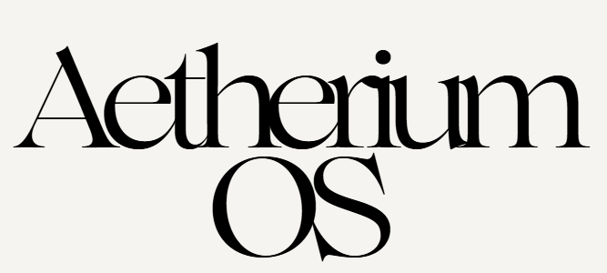
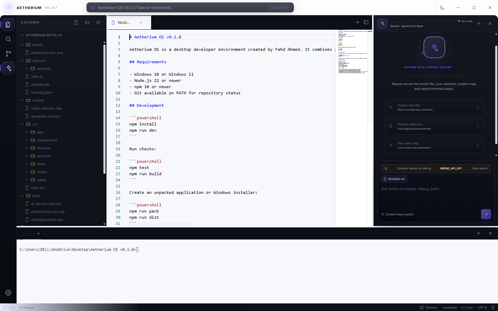

  

  A focused, Gemini-powered developer environment for Windows.

  <a href="https://github.com/F4hdAhmed/Aetherium-OS-/releases/latest">Download latest release</a>
  ·
  <a href="#development">Build from source</a>
  ·
  Created by Fahd Ahmed

## What is Aetherium?

Aetherium OS is not an Operating System but a Code editor Made just for ROBLOX DEVELOPERS For Rojo plugin and more its still WIP but I am working Towards publishing it on NOV 20, 2026

### Included in v0.1.3

- Monaco code editor with local language workers
- Workspace explorer and project-wide search
- In-app creation and multi-file import for text and code files
- Visible New File, New Folder, and Import explorer controls
- Native file dialog with fifteen quick code/text types and custom extensions
- Integrated terminal and run/build controls
- Aether AI powered by the Gemini streaming Interactions API
- Reviewable Aether multi-file plans with explicit Apply and Reject controls
- Optional QR-only donations with no subscriptions, paywall, or feature locking
- Active-file, selection, project-map, and terminal context controls
- Git branch and change status
- Command palette, keyboard shortcuts, themes, and persistent preferences
- Secure Electron process boundary and workspace path validation

## Download

Download the Windows x64 installer from [GitHub Releases](https://github.com/F4hdAhmed/Aetherium-OS-/releases).

> The v0.1.3 installer is not code-signed yet. Windows SmartScreen may show an “Unknown publisher” warning.

## Gemini configuration

Create a Gemini API key in Google AI Studio, then save it as a Windows user environment variable:

~~~cmd
setx GEMINI_API_KEY "YOUR_ACTUAL_GEMINI_KEY"
~~~

Restart Windows or sign out and back in before opening Aetherium. The default model is <code>gemini-3.5-flash</code> and can be changed in **Settings → Aether AI**.

The renderer never receives the API key. Aether sends requests only from Electron's main process to <code>generativelanguage.googleapis.com</code>.

## Keyboard shortcuts

| Shortcut | Action |
| --- | --- |
| Ctrl+P | Quick open |
| Ctrl+Shift+P | Command palette |
| Ctrl+O | Open folder |
| Ctrl+S | Save |
| Ctrl+Shift+S | Save all |
| Ctrl+Backtick | Toggle terminal |
| Ctrl+B | Toggle sidebar |

## Development

Requirements:

- Windows 10 or Windows 11
- Node.js 22 or newer
- npm 10 or newer
- Git available on PATH

~~~powershell
npm install
npm run dev
~~~

Verification and packaging:

~~~powershell
npm test
npm run build
npm run dist
~~~

## Security

- Electron context isolation and renderer sandboxing are enabled.
- Filesystem paths are validated against the active workspace.
- Deleted items are moved to the operating system Recycle Bin.
- AI output is never executed automatically.
- Gemini credentials remain in the Electron main process.
- The AI endpoint is pinned to Google's official Generative Language API.
- External links cannot create renderer windows.

## Status

Aetherium OS v0.1.0 is a developer preview. The next release targets code signing, automatic updates, a fuller Git interface, and the extension runtime.
